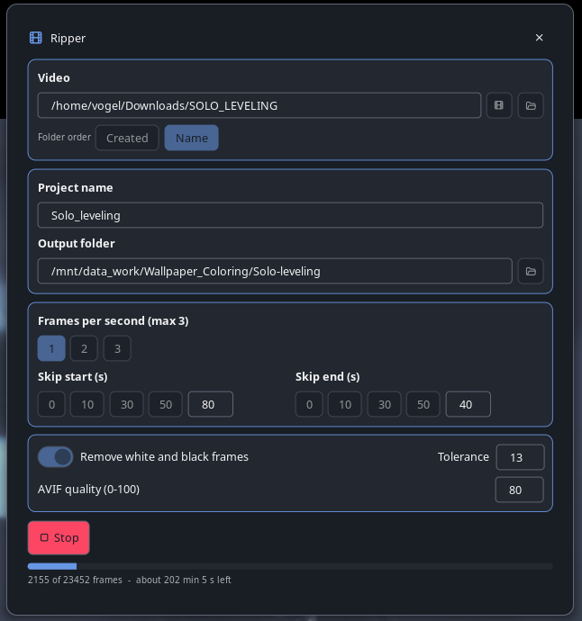

# Ripper

Noctalia panel that turns a video, or a folder of videos, into AVIF frames: frames per second, skip intro and outro, drop all-white and all-black frames.



## Dependencies

`ffmpeg` (with libaom), `yad`, `libnotify`

## Install

From a local clone:

```
noctalia msg plugins source add musqz-ripper path ~/path/to/musqz-ripper
noctalia msg plugins enable musqz/ripper
```

Open the panel: `noctalia msg panel-toggle musqz/ripper:main`

## Use

1. Pick a video (movie button) or a folder of videos (folder button). A folder is read by creation date or by name.
2. Set the project name and the output folder.
3. Set frames per second (1-3), skip start and skip end in seconds (applied to every video).
4. Switch the white/black filter on and set the tolerance (0-40).
5. Set the AVIF quality.
6. Press *Start*.

Frames land in `<output>/<project>/avif/<project>_000001.avif`. An existing project folder is never overwritten; the next run gets `-2`.

## License

MIT
